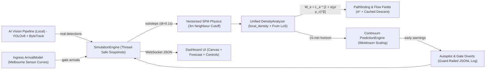

# Crowd Guard

Real-time crowd simulation, AI-powered vision pipeline, bottleneck forecasting, and automated rerouting engine. A predictive digital twin for venue crowd management.

---

## Table of Contents

- [Live Demo](#live-demo)
- [Architecture & Simulation Pipeline](#architecture--simulation-pipeline)
- [Features & Engine Highlights](#features--engine-highlights)
- [Tech Stack](#tech-stack)
- [Getting Started](#getting-started)
  - [Prerequisites](#prerequisites)
  - [Installation & Setup](#installation--setup)
  - [Running the Server](#running-the-server)
  - [Environment Variables](#environment-variables)
- [Usage](#usage)
- [Testing & Benchmarks](#testing--benchmarks)
  - [Test Suite](#test-suite)
  - [Per-Stage Latency Benchmark](#per-stage-latency-benchmark)
  - [Trajectory Recording & Forecast Accuracy](#trajectory-recording--forecast-accuracy)
- [Deploy on Render](#deploy-on-render)
- [Project Structure](#project-structure)

---

## Live Demo

**[https://crowd-guard-mavt.onrender.com](https://crowd-guard-mavt.onrender.com)**

> **Note:**
> - Hosted on Render's free tier, so the first visit after 15 minutes of inactivity takes about a minute to wake up. Please wait for the page to load.
> - The live build runs the simulation, 15-minute forecasting, Recommended Actions (with Divert), and Autopilot. The AI vision pipeline (YOLOv8 + ByteTrack) is disabled there (`ENABLE_VISION=0`) because it needs a camera and GPU—run the project locally to use it.

---

## Architecture & Simulation Pipeline

Each engine tick (`TICK_DURATION_SEC = 0.5` s) is driven by a monotonic wall-clock deadline loop in `backend/main.py` and executed on a worker thread, publishing an immutable state and heatmap snapshot for WebSocket clients.



---

## Features & Engine Highlights

### Vision & AI (Local)
- **AI Vision Pipeline (`backend/vision/pipeline.py`, `backend/vision/aggregator.py`):** Dual-worker YOLO setup (`yolov8n.pt` person detection with ByteTrack tracking via `lap==0.5.14`, plus `yolov8s.pt` vehicle detection), greedy IoU de-duplication, and 4-point ground-plane homography calibration (`calibrate`, with corner-stretch fallback). MiDaS depth estimation (`midas_v21_small.pt`) is retained as optional (`use_depth = False` by default).
- **Vision Language Model (VLM) — currently unavailable:** SmolVLM2 (2.2B GGUF) is wired for keyframe analysis, but `llama-cpp-python` is not installed in this environment and no working version was verified, so it is left unpinned rather than pinning an untested build. The pipeline reports it as unavailable through `initialize()["unavailable"]` instead of failing silently.
- **Hardware Acceleration:** Native PyTorch CUDA 12.8 support. YOLO inference with ByteTrack measured at **19.5 ms/frame** on an RTX 4050.
- **No depth estimation:** MiDaS was removed. It needed `timm` *and* a nested `rwightman_gen-efficientnet-pytorch` torch.hub repo that prompts `Do you trust this repository? (y/N)` on first load — which raises `EOFError` in a non-interactive service. Nothing consumed its output either: `map_to_grid` ignored the depth value, because MiDaS emits relative inverse depth with no metric scale and so cannot correct a ground-plane position.

### Real-Time Physics, Density & Routing
- **Vectorised Social Force Model (`backend/physics.py`):** Evaluates Helbing & Molnar forces over flat `(src, dst)` neighbour-pair arrays within `INTERACTION_CUTOFF = 3.0` m (calibrated with `B = 0.10`, lifting mean crowd walking speed from `0.423 m/s` to `0.995 m/s`; `11.5 ms/tick` at 200 agents vs. `313 ms` in the scalar loop, and `199.6 ms` full tick at 1,000 agents for `2.5×` real-time headroom) and verified to `1e-5` relative tolerance against the scalar reference (`backend/physics_scalar.py`).
- **Unified Local Density & Fruin LoS (`backend/density.py`):** Zone classification, hazard detection, and forecast early warnings all share one `local_density(field, radius=1)` spatial mean (people/m²), preventing mismatched readings across dashboard panels, with per-second rise rates and Fruin Level-of-Service classification (LoS A–F + Critical).
- **Density-Weighted A\* & Cached Flow Fields (`backend/pathfinding.py`):** Routes agents around congestion using $W_e = L_e \cdot [1 + \alpha (\rho_e / \rho_{\text{critical}})^\beta]$ ($\alpha = 2.0$, $\beta = 4.0$, $\rho_{\text{critical}} = 3.5$ p/m²) plus cached multi-source exit potential flow fields (`591 ms` → `1.15 ms` cached per tick at 200 agents; `6.84 ms` rebuild once per `REROUTE_COOLDOWN_TICKS = 10`, capped at `MAX_REROUTES_PER_TICK = 40`).

### Forecasting, Reproducibility & Automation
- **15-Minute Continuum Forecasting (`backend/prediction.py`):** Uses a flux-conserving `continuum` advection model along an 8-connected exit potential with Weidmann speed-density scaling (`jam_density = 5.0` p/m², `PILEUP_DENSITY = 2.17` p/m²), cutting 15-min forecast cost from `~1,133 ms` to `181 ms` while eliminating particle deadlock. The legacy `particles` clone model remains selectable for benchmark comparisons.
- **Stochastic Poisson Arrivals (`backend/ingress.py`):** Injects future arrivals from measured pedestrian sensor curves (City of Melbourne CC BY 4.0 profiles for `gate`, `concourse`, and `food`) using a seeded Poisson process (measured variance/mean = `1.006`), enabling realistic arrival surges rather than zero-variance deterministic counts.
- **Autopilot & Gate Diverts (`backend/autopilot.py`):** Automatically diverts gate arrivals if an operator does not respond within a configurable real-time window, backed by strict guard rails—acts only on imminent pile-ups (`<= 300s` ETA) that are already busy (`>= 1.08` p/m², LoS D+), caps diverts at `70%` (`DIVERT_DURATION_SEC = 120s`), never stacks diverts or closes/throttles gates, resets to OFF on restart, and persists an activity log (`backend/data/autopilot_log.jsonl`, up to 200 entries).
- **Deterministic Seeded Engine (`backend/rng.py`):** Derives independent SHA-256 substreams (`sfm`, `predict`, `ingress`) from a single seed (`DEFAULT_SEED = 1337`, overridable via `CROWD_SEED`), making simulation runs and forecast accuracy checks reproducible.
- **Thread-Safe Snapshots & Monotonic Tick Clock (`backend/main.py`, `backend/simulation.py`):** Schedules ticks against an absolute `time.monotonic()` deadline (re-basing on overrun instead of firing catch-up bursts, bounded by `MIN_TICK_PERIOD_SEC = 0.002` s) and swaps immutable state/heatmap snapshots under `_state_lock` so WebSocket broadcasts never race with the simulation thread.

---

## Tech Stack

| Layer | Technologies |
| :--- | :--- |
| **Backend** | Python 3.10+, FastAPI (`0.165.0`), Uvicorn (`0.54.0`), WebSockets (`17.4`), NumPy (`2.5.5`), Pydantic (`2.14.4`) |
| **AI & Vision** | PyTorch (`2.11.0`, CUDA 12.8 / CPU / MPS), `torchvision`, `ultralytics` (`8.4.219`, YOLOv8), `opencv-python`, `huggingface-hub`. Removed: `timm` (only needed by MiDaS) and depth estimation. `llama-cpp-python` (VLM) is declared but uninstalled and unpinned |
| **Vision Tracking** | ByteTrack (via Ultralytics `model.track()` with `lap==0.5.14`) |
| **Frontend** | Vanilla HTML/CSS/JS with Canvas API |
| **Testing & Benchmarks** | `pytest` (133 tests across 11 files), recorded `.npz` ground-truth trajectories, per-stage latency profiler, and a reliability evaluator for forecast probabilities |

---

## Getting Started

### Prerequisites

- **Windows OS** (recommended for CUDA GPU vision stack)
- **Python 3.10+** (3.12 used in `setup.bat`)
- **NVIDIA GPU** (Recommended: 8GB+ VRAM, e.g., RTX 4060)
- **CUDA Toolkit** and **C++ Build Tools** (only needed if you intend to compile `llama-cpp-python` for the optional VLM)

> **macOS / Linux:** Use `./setup.sh` and `./start.sh` instead of the `.bat` scripts below. There is no CUDA support on these platforms: PyTorch runs on CPU (or MPS on Apple Silicon), and the VLM's `llama-cpp-python` build is optional (Metal-accelerated on macOS, CPU-only otherwise). See the comments inside [setup.sh](file:///f:/CrowdFlowOptimiser/crowd-guard/setup.sh) for the exact commands.

### Installation & Setup

Automated batch scripts are provided for Windows to handle virtual environments, dependencies, and downloading all AI model weights (~1.2GB).

1. **Clone the repository:**
   ```cmd
   git clone https://github.com/ishitathakur22/crowd-guard.git
   cd crowd-guard
   ```

2. **Run the automated setup script** (creates `.venv`, installs PyTorch with CUDA 12.8, installs `llama-cpp-python` for CUDA, installs Python dependencies, and downloads all models to `weights/`):
   ```cmd
   .\setup.bat
   ```

### Running the Server

Once setup is complete, launch the backend and frontend simultaneously:

| Mode | Command | Host / Port | Notes |
| :--- | :--- | :--- | :--- |
| **GPU (Default)** | `.\start.bat` | `0.0.0.0:8001` | Uses CUDA acceleration when available (`--reload`) |
| **CPU Only** | `.\start-cpu.bat` | `127.0.0.1:8001` | Runs all models on CPU and opens the dashboard automatically |
| **macOS / Linux** | `./start.sh` | `127.0.0.1:8001` | Simulation + CPU/MPS (`--reload`) |

Open the dashboard in your browser at:
```text
http://localhost:8001/static/index.html
```
*(or `http://localhost:8001/` — on Windows, avoid opening `http://0.0.0.0:8001/` printed by Uvicorn when running `start.bat`, as browsers treat `0.0.0.0` as `ERR_ADDRESS_INVALID`.)*

### Environment Variables

| Variable | Default | Description |
| :--- | :--- | :--- |
| `ENABLE_VISION` | `1` | Set to `0`, `false`, or `no` to disable the YOLO vision stack (simulation-only mode). |
| `CROWD_SEED` | `1337` | Integer RNG seed controlling all derived simulation, physics, and ingress substreams. |
| `PORT` | `8001` | HTTP/WebSocket port when running `python -m backend.main` (binds `0.0.0.0` if `PORT` is set, else `127.0.0.1`). |

---

## Usage

### 1. AI Vision Pipeline (Local Only)
- Click **Add Files** or **Add Folder** to select local video files (`.mp4`, `.avi`, etc.).
- Click **Scan** to process the videos through the AI pipeline.
- View live **FPS**, **Latency**, **VRAM usage**, and **active models** on the dashboard.
- Live metrics also report per-model inference counts, latency and VRAM (visible when the VLM is compiled).

### 2. Simulation & Digital Twin
- Click **Spawn** to manually add synthetic agents to the simulation.
- Use the **speed controls** (`1×`, `2×`, `5×`, `10×`) to adjust simulation time.
- Toggle visualization layers (**Heatmap**, **Flow**, **Paths**, **Agents**, **Labels**).
- Configure **Expected crowd size**, **Doors open**, and **Surge intensity** in **Event Setup**—or pick a **Day type** preset (*Weekday commute* / *Match day* / *Sell-out surge*)—to control how heavily the venue fills up.
- Monitor density metrics, alerts, and 15-minute predictions in the sidebars.

### 3. Recommended Actions & Autopilot
- **Recommended Actions:** Lists zones the 15-minute forecast expects to hit critical density (soonest first), each with a one-click **Divert** button that reroutes a share of a congested gate's new arrivals to a less-loaded gate.
- **Autopilot:** Turn on **Autopilot** to apply that same divert automatically if nobody responds within a configurable window (`Now` / `15s` / `30s` / `60s` / `90s` / `2m`). It only acts on pile-ups that are both imminent and already busy right now, never closes or throttles a gate, and writes all actions to the **Activity Log** for review.

---

## Testing & Benchmarks

The engine is measured rather than assumed. Every optimisation in this repository is justified by a number that can be regenerated, and every regression is recorded in [benchmarks/README.md](file:///f:/CrowdFlowOptimiser/crowd-guard/benchmarks/README.md).

### Test Suite

```cmd
.\.venv\Scripts\python.exe -m pytest tests -q
```

**132 tests across 11 files**, covering core correctness, physics parity, concurrency safety, and forecast uncertainty:

| File | Guards |
| :--- | :--- |
| `test_reproducibility.py` | Same seed → bit-identical state; different seeds diverge |
| `test_physics_parity.py` | Vectorised SFM is a pure function and matches scalar reference to `1e-5` |
| `test_models.py` | No shared mutable default (e.g., per-instance `Agent.vel`) |
| `test_forecast.py` | Mass conservation, jam-density cap, snapshot counts, finiteness |
| `test_density.py` | Fruin boundaries, unified `local_density` measure, per-second rise-rate units |
| `test_pathfinding.py` | A\* wall avoidance, density weighting, strictly descending flow field |
| `test_ingress.py` | Poisson dispersion (`variance/mean`), rate integration, curve normalisation |
| `test_gates.py` | Admission budget, queue accounting, diverts, open-gate assignment |
| `test_snapshot_and_clock.py` | Concurrent snapshot reads are safe; tick period is independent of tick work |
| `test_vision_aggregator.py` | Detection IoU de-duplication, 4-point homography, out-of-plan handling |
| `test_exceedance.py` | Ensemble variance (`sigma > 0`), probability bounds, divert scaling, autopilot gating, and that the ensemble stays **off** until calibrated |

### Per-Stage Latency Benchmark

Profiles `density`, `physics`, `reroute`, `forecast`, `serialise`, `spawn`, and end-to-end `update()` across crowd sizes (writing `benchmarks/bench_baseline.json`):

```cmd
.\.venv\Scripts\python.exe scripts/bench.py --agents 50 200 500 1000
```

A tick represents `0.5` simulated seconds, so holding `1×` speed means finishing a tick within **500 ms** (`Headroom = 500 ms / tick`):

| Agents | Tick (Before) | Tick (After) | Headroom |
| :--- | :--- | :--- | :--- |
| `50` | 65 ms | **8.3 ms** | 60.4× |
| `200` | 609 ms | **17.0 ms** | 29.4× |
| `500` | 2,051 ms | **57.0 ms** | 8.8× |
| `1,000` | 6,633 ms | **199.6 ms** | 2.5× |

### Trajectory Recording & Forecast Accuracy

Records a deterministic live trajectory (`default` or `surge` scenario) to `benchmarks/trajectory_<scenario>.npz` and evaluates `continuum` vs. `particles` across `MAE`, `busy MAE`, `corr`, `peak err`, and `lead time` against a **persistence baseline** ("density now, unchanged"):

```cmd
.\.venv\Scripts\python.exe scripts/record_trajectory.py --cuts 60 120 180 --horizon-minutes 15
.\.venv\Scripts\python.exe scripts/eval_forecast.py --scenario default --model continuum
```

| Metric | Continuum Forecast | Persistence Baseline |
| :--- | :--- | :--- |
| **MAE** | **0.063** | 0.091 |
| **Busy-cell MAE** | 1.028 | **0.762** |
| **Field correlation** | 0.048 | **0.183** |

> **Honest Assessment:** The continuum forecast beats persistence on overall MAE (and runs in `199 ms` vs. `626 ms` for the particle clone), but still trails persistence on busy-cell MAE and spatial correlation. See [benchmarks/README.md](file:///f:/CrowdFlowOptimiser/crowd-guard/benchmarks/README.md) for the full accuracy breakdown, reverted experiments, and scenario limitations.

#### Exceedance Probability & Bottleneck Lead Time

> **Status: implemented, measured, and disabled.** An ensemble can report a per-cell probability of reaching the pile-up threshold (`p_exceed`), and the wiring exists throughout — warnings carry it, the divert is scaled by it, the Autopilot gates on `AUTO_MIN_P_EXCEED`. But `scripts/eval_reliability.py` measured it against recorded truth and found it **not calibrated**:
>
> | Scenario | Base rate | Expected calibration error | Mean predicted vs observed |
> | :--- | :--- | :--- | :--- |
> | hotspot | 0.97 | **0.917** | 0.09 vs 0.97 |
> | default | 0.24 | **0.589** | erring the opposite way |
>
> It fails in *both directions* depending on regime, so it is a rescaled replicate count, not a probability. `ensemble_replicates = 0` is therefore the default. The mechanism is kept and tested, ready for the day a reliability check passes. A safety number that claims confidence it has not earned is worse than no number at all.

A tightened-chokepoint scenario (`scripts/record_hotspot.py`: 956 agents, peak 8.67 p/m², 96% of ticks above LoS E) made **bottleneck lead time** measurable for the first time:

| Cut | Agents | Lead time | Matched | Missed |
| :--- | :--- | :--- | :--- | :--- |
| `60s` | 464 | **110.0 s** | 24 | 261 |
| `120s` | 515 | 55.4 s | 26 | 273 |
| `180s` | 590 | 55.6 s | 27 | 288 |

Up to **110 seconds of warning** — but in that dense regime the forecast loses to persistence harder than anywhere else (MAE `0.653` vs `0.496`, population drained 476–826 short, ~8% recall). The over-drain is therefore **scale-dependent**, not merely spatial.

When enabled it costs real latency: at 200 agents headroom falls `29× → 13×`, at 500 agents `8.8× → 2.7×`. With it off (the default) the engine holds **1.21× real time at 1,000 agents**.

---

## Deploy on Render

Live deployment: **[https://crowd-guard-mavt.onrender.com](https://crowd-guard-mavt.onrender.com)**

This repository includes a `render.yaml` blueprint configured for Render's free tier (Python web service, persistent WebSockets, 512 MB RAM).

### Deployment Steps

1. Fork or push this repository to your GitHub account.
2. Sign in to [Render](https://render.com) and navigate to **Blueprints → New Blueprint Instance**.
3. Connect your GitHub repository. Render will detect `render.yaml` and configure the service automatically:

   | Setting | Value |
   | :--- | :--- |
   | **Environment** | Python |
   | **Plan** | Free |
   | **Build Command** | `pip install -r requirements-deploy.txt` |
   | **Start Command** | `uvicorn backend.main:app --host 0.0.0.0 --port $PORT` |
   | **Health Check Path** | `/health` |
   | **Environment Variables** | `ENABLE_VISION=0` |

4. Click **Apply**. Once deployed, open the assigned `https://<service-name>.onrender.com` URL to view the live simulation.

> **Note on Free Tier:**
> - Free web services on Render automatically spin down (sleep) after 15 minutes of inactivity. Incoming requests wake the instance up, which takes about a minute on a cold start.
> - The deployed build runs with `ENABLE_VISION=0` to stay within the 512 MB RAM allowance. The simulation, digital twin physics, 15-minute predictive forecasting, Recommended Actions, gate divert routing, and Autopilot are fully functional, while the local AI vision stack (YOLOv8 + ByteTrack) is disabled.

---

## Project Structure

```text
crowd-guard/
├── backend/
│   ├── autopilot.py          # Guard-railed auto-divert engine & JSONL activity log
│   ├── data/                 # Arrival profiles, autopilot log, vision calibration
│   ├── density.py            # Unified local_density() & Fruin LoS classification
│   ├── ingress.py            # Measured arrival curves (Melbourne CC BY 4.0) + Poisson draws
│   ├── main.py               # FastAPI app, WebSocket hub & monotonic-deadline tick loop
│   ├── models.py             # Pydantic schemas, agent profiles & gate state models
│   ├── pathfinding.py        # Density-weighted A* & cached exit flow fields
│   ├── physics.py            # Vectorised Social Force Model over neighbour pairs
│   ├── physics_scalar.py     # Scalar SFM reference implementation for parity tests
│   ├── prediction.py         # 15-min continuum advection & particle forecast models
│   ├── rng.py                # SHA-256 derived deterministic RNG substreams
│   ├── simulation.py         # Core simulation engine & thread-safe snapshot publisher
│   └── vision/               # YOLOv8 + ByteTrack, aggregator, model manager
├── frontend/                 # Dashboard UI (HTML/CSS/JS, Canvas rendering)
├── benchmarks/
│   ├── README.md             # Tracked: measured baselines, reverted experiments, method
│   └── *.json, *.npz         # Generated by the scripts below (git-ignored)
├── scripts/
│   ├── bench.py              # Per-stage latency profiler across crowd sizes
│   ├── build_arrival_profiles.py  # Arrival curve builder from sensor data
│   ├── checks.py             # Seven end-to-end verification checks
│   ├── eval_forecast.py      # Forecast accuracy scorer vs. persistence baseline
│   ├── eval_reliability.py   # Is p_exceed a calibrated probability? (ECE, Brier)
│   ├── record_trajectory.py  # Deterministic ground-truth trajectory recorder
│   └── record_hotspot.py     # High-density recorder that reaches LoS E
├── tests/                    # 133 pytest tests across 11 modules
├── weights/                  # Downloaded AI model weights (populated by download_models.py)
├── download_models.py        # Downloads YOLOv8 (+ optional SmolVLM2) weights
├── render.yaml               # Render free-tier deployment blueprint
├── requirements.txt          # Pinned local dependencies (including vision/GPU stack)
├── requirements-deploy.txt   # Pinned headless deployment dependencies (simulation-only)
├── setup.bat / setup.sh      # Automated environment & model setup scripts
└── start.bat / start-cpu.bat / start.sh  # Server launchers (GPU / CPU / macOS-Linux)
```
